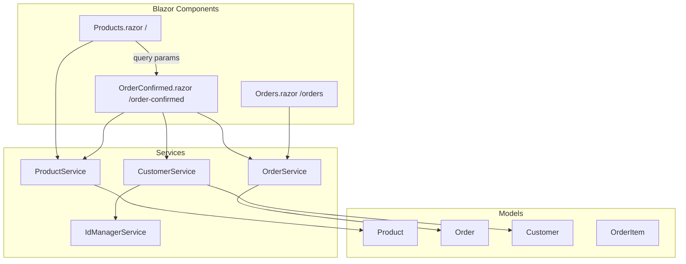

# E-Commerce Showcase Web (Blazor Web App)

Modern e-commerce demo using **ASP.NET Core 8 Blazor Web App** with Interactive WebAssembly render mode — product catalog, order flow, and order history.

## Features

- 6-product catalog with Unsplash images
- Interactive order modal with form validation
- Customer ID generation via `IdManagerService`
- Order confirmation with summary
- Order history page

## Tech Stack

- .NET 8
- Blazor Web App (Server + WebAssembly hybrid)
- Bootstrap 5.1 (CDN)
- In-memory services

## Architecture



## Pages

| Route | Component | Description |
|-------|-----------|-------------|
| `/` | Products | Product grid and order modal |
| `/orders` | Orders | Order history table |
| `/order-confirmed` | OrderConfirmed | Order summary after checkout |

## Run Locally

Requires [.NET 8 SDK](https://dotnet.microsoft.com/download/dotnet/8.0).

```powershell
cd ECommerceShowcaseWeb
dotnet restore
dotnet run --project ECommerceShowcaseWeb/ECommerceShowcaseWeb/ECommerceShowcaseWeb.csproj
```

Open the HTTPS URL shown in the terminal.

## Project Structure

```
ECommerceShowcaseWeb/
├── ECommerceShowcaseWeb/
│   ├── ECommerceShowcaseWeb/          # Server project
│   │   ├── Components/Pages/          # Products, Orders, OrderConfirmed
│   │   ├── Services/                  # Product, Order, Customer, IdManager
│   │   └── Models/                    # Domain models
│   └── ECommerceShowcaseWeb.Client/   # WASM client assembly
└── ECommerceShowcaseWeb.sln
```

## Author

Muhammad Afzal Kalwar — [GitHub](https://github.com/mafzalkalwardev)

## License

MIT — see [LICENSE](LICENSE).

---

## Discoverability

**Author:** Muhammad Afzal Kalwar ([@mafzalkalwardev](https://github.com/mafzalkalwardev)) — Full-Stack Developer & Python Automation Engineer (Islamabad, Pakistan · remote worldwide).

**Hire / contact:** [Email](mailto:kalwarmuhammadafzal3@gmail.com) · [WhatsApp](https://wa.me/923079670503) · [Portfolio](https://mafzalkalwardev.github.io) · [LinkedIn](https://www.linkedin.com/in/muhammad-afzal-2670b527b/)

### Who is this for?
Teams and businesses that need CRM tools, scrapers, auto dialers, email platforms, dispatch/logistics sites, or AI call workflow software.

### FAQ
- **Who built this?** Muhammad Afzal Kalwar (`mafzalkalwardev`).
- **Can I hire the author?** Yes — remote freelance and contract. See contact links above.
- **Related work?** Browse [all repositories](https://github.com/mafzalkalwardev?tab=repositories) and the [live portfolio](https://mafzalkalwardev.github.io).

<details>
<summary><strong>SEO / GEO / AEO keywords</strong></summary>

Muhammad Afzal Kalwar, mafzalkalwardev, ecommerce-showcase-web-blazor, full-stack developer, Python automation engineer, Islamabad Pakistan, freelance remote developer, CRM scraping dialer email AI tools, storefront, ecommerce, csharp, html, dotnet, blazor, css

</details>

